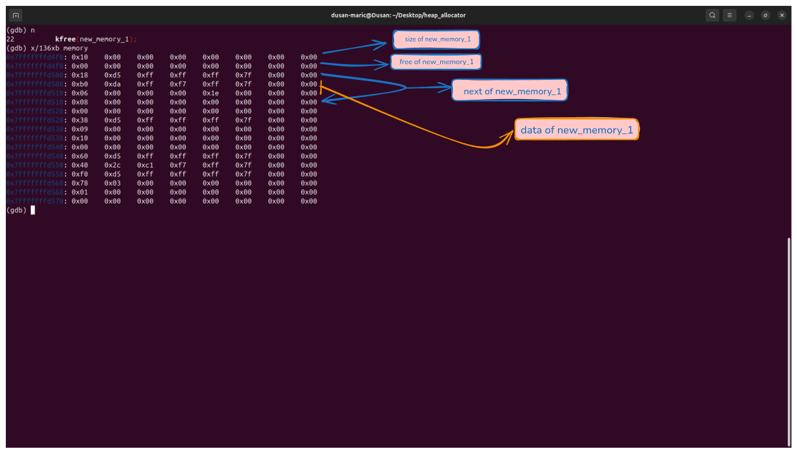
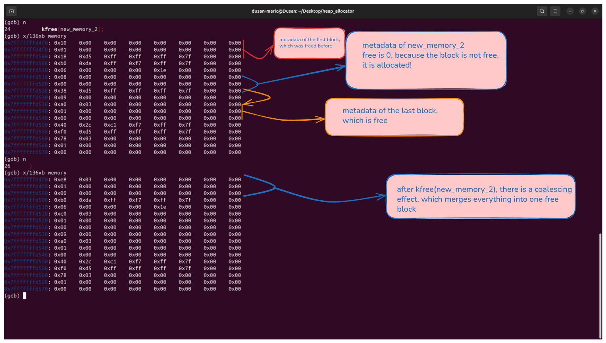

# Heap Allocator

## Project description

A basic heap allocator that manages a given memory region.

## Memory layout and debugging

### Screenshots for test_coalescing function

This picture illustrates the block structure.


This picture illustrates how coalescing works.


## Features

This memory allocator has three main functions:

- allocator_init - this is used to initialize the region
- kmalloc - this is used to allocate a portion of memory and returns pointer to that memory, it uses first-fit strategy and 8-byte alignment
- kfree - this is used to free already allocated memory, it uses basic coalescing free blocks are being merged, there is a basic pointer validation and some safety measures against double free (ignore)

## Block structure

The block structure has 3 fields:
- size - this is user-free space, the size of block metadata is not included
- free - indicates whether the block is free (1) or allocated (0)
- next - it is a pointer to the next block

## Building and running

To build the project, run:

```bash
make
```

After that, run the executable:
```bash
./heap_allocator
```
## Limitations

This allocator manages only given memory region and it is not a kernel memory manager. Kfree has O(n) time complexity due to linear traversal of the block list for validation and locating the previous block.
