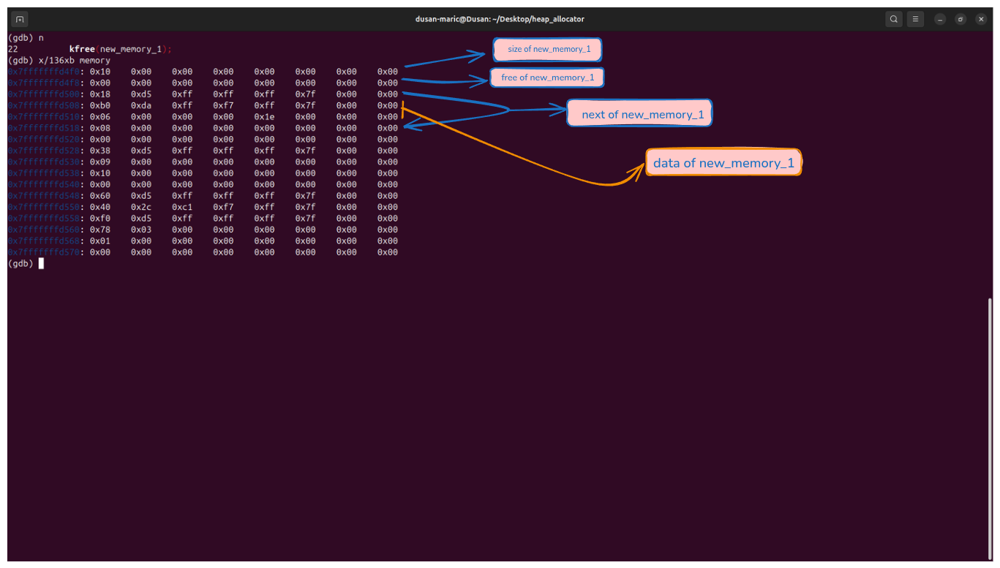
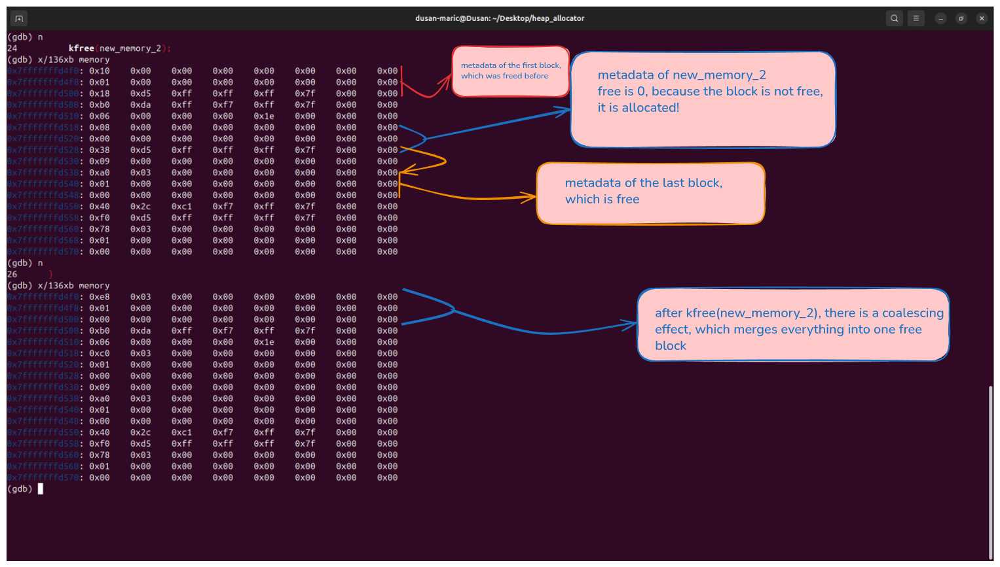
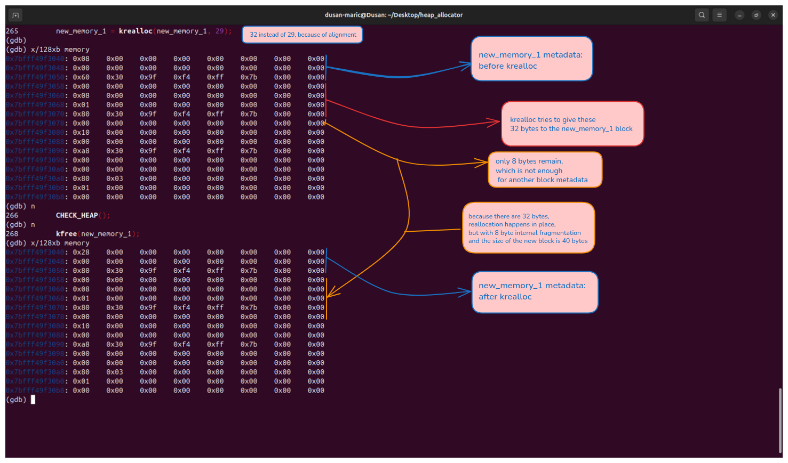
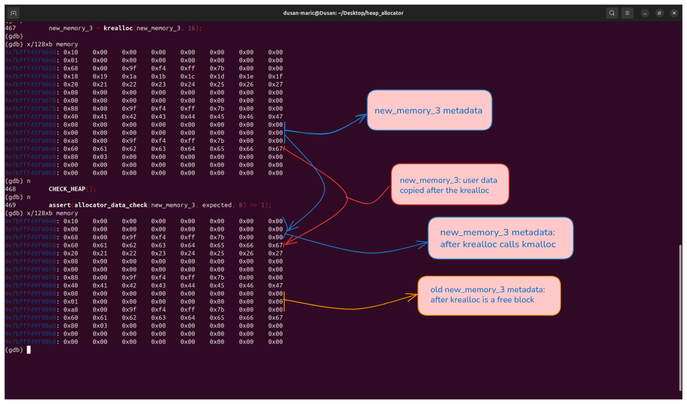

# Heap Allocator

## Project description

A simple heap allocator implemented from scratch in C and stress-tested with 20 million random operations. It manages a memory region provided by caller and provides basic dynamic memory allocation and reallocation functionality.

## Memory layout and debugging

### Screenshots for test_coalescing function

This picture illustrates the block structure.


This picture illustrates how coalescing works.


### Screenshots for krealloc 

#### Krealloc internal fragmentation in the test_krealloc_expansion_not_enough_space function
This picture illustrates how in place reallocation happens with the cost of internal fragmentation


#### Krealloc calls kmalloc, because the next block is not free
This picture illustrates how the allocator behaves when the next block is not free and kmalloc is successful in the test_krealloc_next_block_not_free_kmalloc function.


## Features

This memory allocator has four main functions:

- allocator_init - this is used to initialize the region
- kmalloc - this is used to allocate a portion of memory and returns a pointer to that memory, it uses first-fit strategy and 8-byte alignment
- kfree - this is used to free already allocated memory, it uses coalescing and neighboring free blocks are merged, there is a basic pointer validation and some safety measures against double free (ignore)
- krealloc - reallocates an existing memory block. It supports both shrinking and expanding, attempting to resize blocks in place whenever possible. If in-place expansion is not possible, it allocates a new block and copies the existing data.

## Block structure

The block structure has 3 fields:
- size - this is user-free space, the size of block metadata is not included
- free - indicates whether the block is free (1) or allocated (0)
- next - it is a pointer to the next block

# Testing

The allocator was tested using 16 cases written by me. Also, in allocator_debug.h there is a small API for testing. It includes these functions:

- allocator_validate - the main function that checks allocator's invariants
- allocator_data_check - checks whether two arrays have the same first size bytes (size is the argument of the function)
- copy_memory - a basic function that copies a number of size bytes to a new array

Those functions were used to determine, if allocator is working according to expectations. 
Additionally, the allocator was tested using stress tests with 100 different seeds. Every seed has 200 000 random operations and all test runs passed successfully.

## Building and running

To build the project, run:

```bash
make
```

After that, there will be an object file named allocator.o.

To build the project in the testing mode run:
```bash
make test
```
All of the testing "settings" are in test_allocator.c
## Known Limitations

This allocator manages only given memory region and it is not a kernel memory manager. 
Kfree and krealloc have O(n) time complexity due to linear traversal of the block list for validation and locating the previous block.
It is not thread-safe and it only has 8-byte alignment.
Each block requires 24 bytes of metadata on a typical 64-bit platform.
The allocator has only been tested on Ubuntu 24.04(x86_64).
